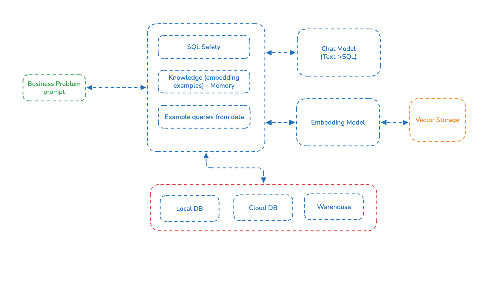

# DB Agent — Text-to-SQL AI Agent for Databricks, Postgres,Snowflake and AWS

> An open-source **text-to-SQL AI agent** that converts natural language into safe SQL, with production deployment patterns for **Databricks Apps**, **Postgres/MySQL**, and cross-agent memory on **AWS S3 Vectors**. Schema-aware prompt engineering, SQL safety guardrails (SELECT-only validation), knowledge files, and result-set benchmarks you can deploy at work.

---


[](https://db-agent-pg42.onrender.com/)
[](https://becloudready.com/webinar/db-agent?utm_source=github&utm_medium=referral&utm_content=badge)

---

**Featured In**

- **AAAI-25 Workshop on Open-Source AI for Mainstream Use** (Philadelphia, March 2025) — DB Agent presented as a reference implementation for production text-to-SQL agents. [Workshop program](https://the-ai-alliance.github.io/AAAI-25-Workshop-on-Open-Source-AI-for-Mainstream-Use/program/) · [Paper](./assets/OSAI4MU-25_submission_paper_v2_format.pdf)

---

## What is DB Agent?

DB Agent is a minimal **natural-language-to-SQL system**. A user asks a question in plain English; DB Agent retrieves relevant schema context, prompts an LLM to generate a SQL query, validates the query against a SELECT-only safety layer, executes it against the target database, and returns the results with every intermediate step visible. The primary implementation is a **Node.js/React app** that runs locally in one command or deploys natively to **Databricks Apps**.


---

## Features

- **Text-to-SQL** — natural language to SELECT queries via any LLM
- **Safety layer** — blocks all write/admin SQL before it reaches the database
- **Explainability** — schema context, generated SQL, and validation all visible
- **Any OpenAI-compatible LLM** — Databricks Model Serving, OpenAI, Groq, Ollama, LM Studio
- **SQL backends** — Databricks SQL (Unity Catalog), PostgreSQL (including Lakebase), SQLite, and DuckDB over MinIO
- **Two bills, both visible** — per-answer LLM token cost and warehouse compute cost (`EXPLAIN` / `EXPLAIN COST`), with approval for expensive queries
- **Ontology (knowledge file)** — descriptions, synonyms, example queries, and rules injected into the prompt; `db-agent scan` drafts one from your schema, and an accuracy test scores answers with and without it
- **MCP gateway** — Claude Desktop, VS Code, and Claude Code query the same database through one set of rules, with per-caller keys, budgets, and an audit log
- **Agentic Memory** — redacted, cross-agent memory over a shared store (local JSONL or AWS S3 Vectors)
- **Benchmarks** — question + ground-truth SQL pairs scored on result sets, with UI and CI integration

---

### Architecture



## Quick start

| | Local | Databricks Apps |
|---|---|---|
| **Stack** | Node.js + Express + React | Same app, native Databricks App |
| **LLM** | Ollama or any OpenAI-compatible | Databricks Model Serving or any OpenAI-compatible |
| **Memory** | Local JSONL or AWS S3 Vectors | Lakebase pgvector |

**Run locally** (Databricks SQL + Ollama):

```bash
cd app
cp .env.example .env    # set DATABRICKS_* warehouse credentials
ollama pull qwen2.5-coder:7b
./run_local.sh
```

Open `http://localhost:3001`. Any OpenAI-compatible endpoint works instead of Ollama; see [`app/.env.example`](./app/.env.example).

**Docker, no cloud account** (Postgres demo data): see [`app/README.md`](./app/README.md#docker-demo-postgres-no-cloud-account).

**Databricks Apps:**

## Deploy db-agent in Databricks with labagent on Windows

```powershell
# 1. Install prerequisites & labagent
winget install Python.Python.3.14
Invoke-WebRequest -Uri https://bootstrap.pypa.io/get-pip.py -OutFile get-pip.py
python get-pip.py
pip install labagent

# 2. Install Databricks CLI
winget install Databricks.DatabricksCLI

# 3. Authenticate Databricks
$env:DATABRICKS_AUTH_STORAGE="plaintext"
databricks auth login

# 4. Launch DB Agent
labagent launch db-agent --name demo-1 --param profile=DEFAULT
```

**More:** [ontology and scan](./app/docs/ontology.md) · [MCP gateway](./app/docs/mcp-gateway.md) · [full configuration](./app/README.md)

---

## Workshops & Training

Hands-on bootcamps on text-to-SQL agents, ontologies, and Databricks deployment patterns. Private team workshops: contact [BeCloudReady](https://calendly.com/kchandank/30-mins-meeting) . Community: [TorontoAI](https://toronto-ai.org/), 10,000+ data and AI practitioners.

---

## Maintained by

[BeCloudReady](https://becloudready.com/) . Organizers of [TorontoAI](https://toronto-ai.org/).

[Book a discovery call](https://calendly.com/kchandank/30-mins-meeting) for customized training and consulting.
