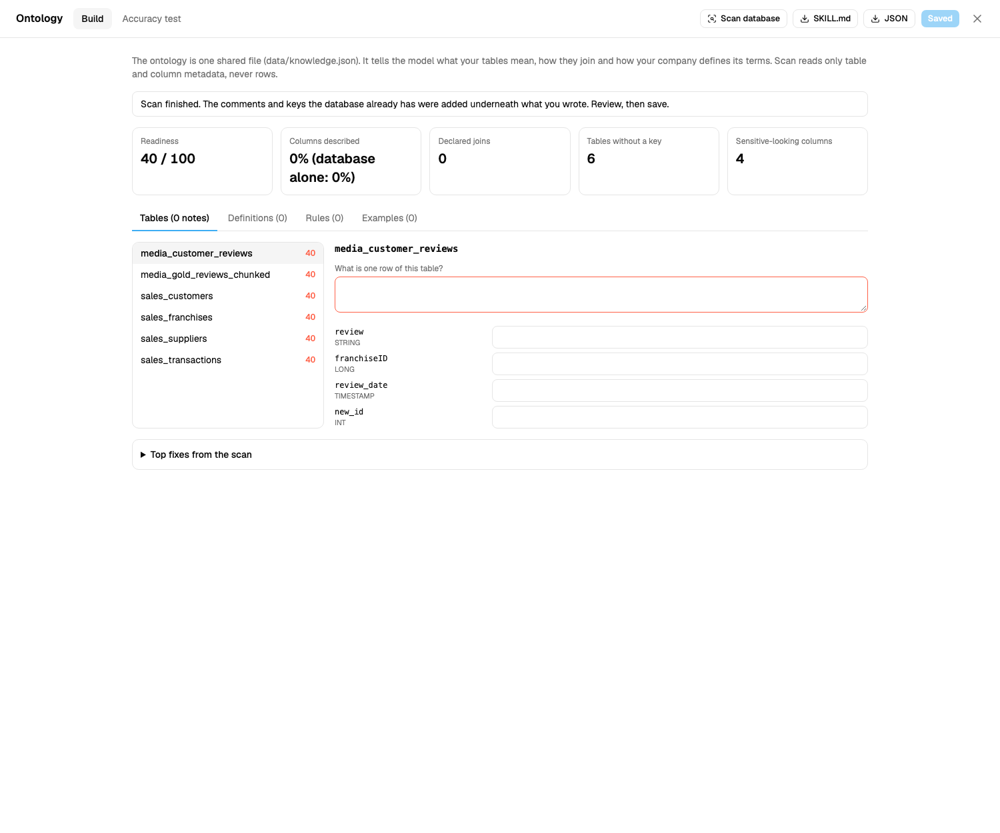
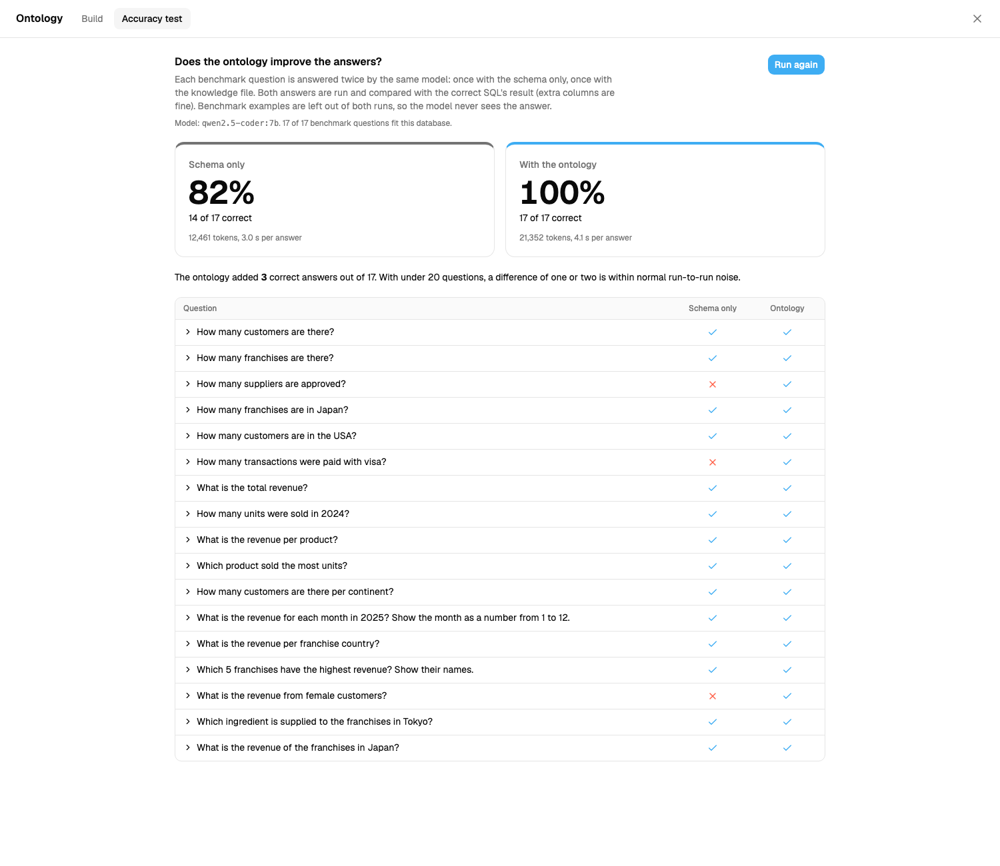
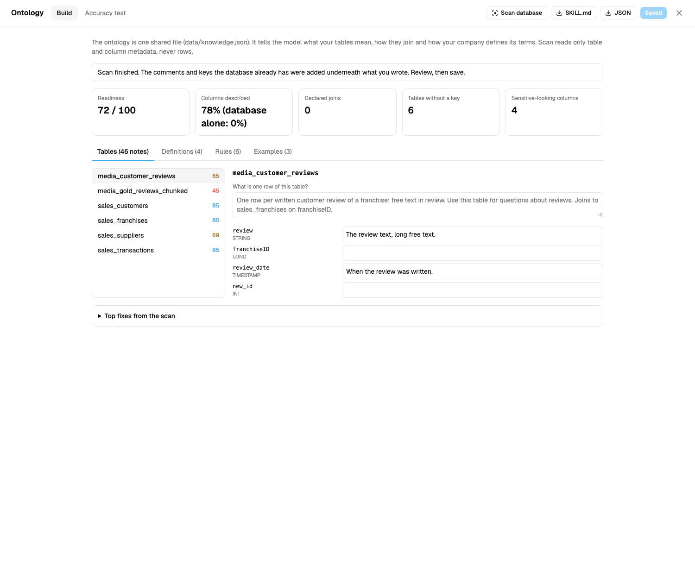

# Ontology for AI Database Agents: Why Model Size Matters Less Than You Think

*I gave the same models the same questions with and without a written-down ontology, on AdventureWorks and on a Databricks dataset with no comments at all. For text-to-SQL in an AI database agent, the ontology moved accuracy more than the choice of model did, and a free local 7B model with an ontology matched a 120B cloud model without one.*

Most conversations about text-to-SQL accuracy are about the model: a bigger one, a SQL-specialist one, a better prompt. I ran a set of tests on [db-agent](https://github.com/db-agent/db-agent), an open-source natural-language-to-SQL layer, and the biggest lever I found was none of those. It was a plain text file that says what the data means.

## The short version

- On AdventureWorks (68 tables, 5 schemas), a 7B model answered **7 of 17** questions correctly from the schema alone. The database's own comments moved that to **8**. A hand-written ontology moved it to **14**.
- On a Databricks copy of the Bakehouse sample dataset, which has **no comments at all**, the same model went from **14 of 17 to 17 of 17**. The three it got wrong were not hard SQL. They were value conventions the schema does not contain: `'Y'` instead of `'Yes'`, `visa` instead of `Visa`, `female` instead of `F`.
- In a separate check of 16 hand-picked prompts, 7 gave a different, wrong-versus-right answer with the ontology and 9 made no difference.
- In the same tests, swapping the model changed the score by about 2 questions. Adding the ontology changed it by 3 to 7.
- A general 7B model with an ontology (14 of 17) beat a SQL-specialist 7B model that had only the schema (9 of 17) on AdventureWorks.
- **Free local model against a 120B cloud model:** on the Databricks data, a 7B model running locally in Ollama with an ontology scored **17 of 17**. OpenAI's `gpt-oss-120b` on Groq, with the schema alone, scored **15 of 17**, and still returned 0 rows for one question that depends on a value only the data knows.
- **Cost:** the local model costs nothing per token. The 120B model cost roughly 0.01 to 0.09 US cents per question at Groq's list price. That is cheap, and it still scales with volume and with the size of the ontology you send.
- I tested models from 0.5B to 7B locally and one 120B open-weight model in the cloud. I did not test a closed frontier model, so this article does not claim a small model beats one.
- My first Bakehouse run showed **no gain** (10 correct without, 9 with). The ontology was not reaching the model. Writing it was not enough: it also has to be found.
- The ontology costs tokens: about 520 extra input tokens per question in my run.

These are small tests, run by one person, and I list their limits below. Treat the numbers as evidence of a pattern, not as a benchmark.

## What I tested

- **Tool:** db-agent, which turns a question into SQL, checks that it is read-only, runs it, and shows the result with a token and warehouse cost estimate.
- **Model:** `qwen2.5-coder:7b` running locally in Ollama, unless noted. Temperature 0.
- **Data 1:** AdventureWorks 2014 OLTP in Postgres: 68 tables in 5 schemas (89 with views), 111 MB, 31,465 orders.
- **Data 2:** the Databricks `bakehouse` sample (customers, franchises, suppliers, reviews, and sales transactions), in my own copy with 4,000,000 transactions. The copy carries no table or column comments.
- **Questions:** 17 per dataset, each with a ground-truth SQL query. An answer counts as correct when the rows its SQL returns match the rows of the ground truth. Extra columns are allowed. The SQL text is never compared.
- **Conditions:** the model sees (a) the schema only, or (b) the schema plus a knowledge file. Benchmark questions are kept out of the prompt in both, so the model never sees an answer.

## What I mean by an ontology

Here I mean a small file that holds four things the schema cannot tell you:

```json
{
  "descriptions": {
    "sales_suppliers.approved": "'Y' when the supplier is approved. Every supplier is currently 'Y'.",
    "sales_transactions.paymentMethod": "Card network, lowercase: visa, mastercard or amex.",
    "sales_customers.gender": "Lowercase text: female or male.",
    "sales_franchises.country": "The United States is 'US' here, not 'USA'."
  },
  "expressions": {
    "revenue": "SUM(totalPrice) over sales_transactions"
  },
  "instructions": [
    "Each row of sales_transactions is one sale of one product. There is no orders table.",
    "Never select cardNumber or email_address unless the question asks for them."
  ],
  "examples": [
    { "question": "How many suppliers are there on each continent?",
      "sql": "SELECT continent, count(*) FROM sales_suppliers GROUP BY continent" }
  ]
}
```

Column descriptions, business definitions, house rules, and a few worked examples. It is not a knowledge graph or an OWL file. It is the thing a new analyst gets told in their first week.

## Result 1: AdventureWorks

| Model and context | Schema only | + the database's own comments | + a hand-written ontology |
|---|---|---|---|
| qwen2.5-coder 1.5B | 5 / 17 | 4 / 17 | 8 / 17 |
| qwen2.5-coder 7B | 7 / 17 | 8 / 17 | **14 / 17** |

AdventureWorks is a good case because it already has 427 table and column descriptions stored in the database. Using them barely helped: 7 to 8 for the 7B model. What helped was the part a person adds: how a customer is defined (a person or a store), the join path from a product to its category, net revenue after discounts (the table has no line total column), and a few rules. The 7B model went to 14.

The ontology answers also used fewer tokens in total (111k against 154k), because the model needed fewer failed attempts and repairs.

## Result 2: a database with nothing written down

For the Bakehouse data I took the sample tables, copied them into my own schema, and scaled the sales table to 4 million rows. The copy has no comments, so the starting point is zero.



The scan reads only metadata (names, types, comments, declared keys, never rows) and reports 40 out of 100, nothing described, no declared joins, four sensitive-looking columns. Then I wrote the ontology once, from the real data, and ran the same 17 questions twice:



Three questions flip, and they flip for a boring reason:

| Question | Without the ontology | With it |
|---|---|---|
| How many suppliers are approved? | `WHERE approved = 'Yes'` returns **0** | `WHERE approved = 'Y'` returns **27** |
| How many transactions were paid with visa? | `paymentMethod = 'Visa'` returns **0** | `paymentMethod = 'visa'` returns **1,332,880** |
| What is the revenue from female customers? | `gender = 'F'` returns **null** | `gender = 'female'` returns **35,881,278** |

Nothing here is a hard query. The model wrote valid SQL, ran it, and got an empty answer with no error. That is the dangerous kind of wrong: it looks like a result. The schema says the columns are strings. Only the data, or a person who knows it, says which strings.

After the ontology was saved, the same scan reads 72 out of 100 and 78% of columns described, while "database alone" stays at 0%.



### Seven more prompts

The accuracy test has a fixed set of questions. To see how widely this reaches, I then typed 16 prompts into two running instances, one without the ontology and one with it, and compared the SQL and the answer. Seven of them came out wrong without the ontology and right with it:

| Prompt | Without the ontology | With the ontology |
|---|---|---|
| How many suppliers are approved? | `approved = 'Yes'` returns 0 | `approved = 'Y'` returns 27 |
| How many transactions were paid with visa? | `paymentMethod = 'Visa'` returns 0 | `paymentMethod = 'visa'` returns 1,332,880 |
| What is the revenue from female customers? | `gender = 'F'` returns null | `gender = 'female'` returns 35,881,278 |
| How many male customers are there? | `gender = 'Male'` returns 0 | `gender = 'male'` returns 149 |
| How many customers live in the United States? | `country = 'United States'` returns 0 | `country = 'USA'` returns 99 |
| How many franchises are in the United States? | `country = 'United States'` returns 0 | `country = 'US'` returns 16 |
| How many American Express payments were there? | `paymentMethod = 'American Express'` returns 0 | `paymentMethod = 'amex'` returns 1,332,466 |

The two "United States" rows are the instructive pair. Customers write the country `USA`, franchises write it `US`, in the same database. No model can guess both. A person can say so in one line, and once it is written down the model gets both right.

Nine prompts made no difference to the answer: how many XXL franchises, the average sale value, the best-selling product, revenue per payment method, which suppliers provide cacao, how many suppliers are in North America, how many reviews there are, the largest franchise, and customer emails in Japan. Where the SQL differed it was cosmetic (`LIKE '%cacao%'` against `= 'cacao'`, an extra column). An ontology does not change everything. It matters where the data has conventions that the schema does not show, and in this dataset that was most of the text columns with a fixed set of values.

You can also do this live, in a minute. On an instance with no ontology I typed three one-line notes (the `approved`, `paymentMethod` and `gender` lines in the file above) and saved. All three answers flipped to correct on the next question.

## The twist: my first run showed nothing

My first Bakehouse run scored **10 correct without the ontology and 9 with it**. If I had stopped there, the conclusion would have been "an ontology does not help".

It did not help because it was not reaching the model. db-agent only added a column note to the prompt when the question contained the exact table name. The table is `sales_suppliers`. The question says "suppliers". No match, no note, and the model guessed `'Yes'` again. AdventureWorks partly hid this: its table names (`customer`, `product`) are words people use.

I added an opt-in matching mode that matches on words from table and column names and ignores plurals. With that change (and two scoring fixes, see limits): **11 against 14**.

The lesson I take from this is that an ontology has two jobs. Writing it is one. Getting the right line in front of the model at the right moment is the other, and a system that does only the first looks like it does nothing.

## The runs, in order

I changed things between runs, so here they are all, not just the best one.

| Run | What changed | Without | With |
|---|---|---|---|
| 1 | First measurement | 10 | 9 |
| 2 | Loose matching of notes, one ground-truth fix, extra columns allowed | 11 | 14 |
| 3 | Cost guard relaxed so aggregates run (see limits) | 13 | 15 |
| 4 | Two questions changed (see limits) | 14 | 17 |
| 5 | Re-run | 14 | 17 |

Runs 4 and 5 are identical, which is expected at temperature 0: repeating a run is a check that the harness is stable, not independent evidence.

## What did not help

- **Pruning the schema to relevant tables.** The idea is that a model confused by 87 tables does better with 10. For the 7B model it made no clear difference (8, 9 and 12 against 7, 8 and 14 without pruning). The 1.5B model does invent tables and columns when shown all 87, but it still scored only 8 of 17 with the ontology.
- **A SQL-specialist model.** I tried `sqlcoder-7b-2`. With the schema alone it matched or beat the general model (8 to 9 of 17). Given an ontology it did not improve (9, 8, 8), and it was slower. It also copied the JSON answer template into its SQL until I let it answer with bare SQL. Specialised for SQL is not the same as good at using context.
- **A bigger model.** Going from 1.5B to 7B changed the schema-only score from 5 to 7. The ontology changed 7 to 14.

## Model size and quality against the ontology

Models are the part everyone tunes, so here are the model comparisons I have, on the same 17 AdventureWorks questions:

| Comparison | Score | Change |
|---|---|---|
| 1.5B model, schema only, then 7B model, schema only | 5, then 7 | +2 for a model about 5 times larger |
| 7B model, schema only, then a SQL-specialist 7B model (sqlcoder), schema only | 7, then 9 | +2 for a model trained for SQL |
| 7B model, schema only, then the same 7B model with an ontology | 7, then 14 | **+7** |
| SQL-specialist 7B model, schema only, against the general 7B model with an ontology | 9 against **14** | the general model with the ontology wins |
| 7B model, schema only, against the 1.5B model with an ontology | 7 against 8 | about equal: the small model with an ontology matched the larger one without |
| *Bakehouse:* 7B model, schema only, then the 120B model, schema only | 14, then 15 | +1 for about 17 times the total parameters |
| *Bakehouse:* 7B model, schema only, then the 7B model with an ontology | 14, then 17 | **+3** |
| *Bakehouse:* the 120B model, schema only, against the 7B model with an ontology | 15 against **17** | the free local model with the ontology matches or beats it |

Every one of these rows is one run on 17 questions, so a difference of one or two questions is noise. What I read from the pattern is that a bigger or better-trained model fixes some errors, and an ontology fixes a different kind: the ones where the answer is a fact about your data, not a skill. A bigger model cannot know that your table stores `'Y'` where it expected `'Yes'`.

What I did not test is a closed frontier model. The 120B model I did test is a strong open-weight model, not the best closed model available, and a closed model may do better.

## A free local model against a 120B cloud model

The point I most wanted to check: can a model you run for free get the accuracy of a much larger one you pay for per token? I ran the Bakehouse questions on `gpt-oss-120b` through Groq (120B parameters in total, about 5B active per token, a reasoning model, run at low reasoning effort) and compared it with the local 7B model:

| Model | Schema only | With the ontology |
|---|---|---|
| `qwen2.5-coder` 7B, local in Ollama | 14 / 17 | **17 / 17** |
| `gpt-oss-120b`, Groq | **15 / 17** | 16 / 17 |

Three things stand out:

1. **The 120B model guessed more conventions on its own.** It got the visa question and the female-customers question right without being told, where the 7B wrote `'Visa'` and `'F'`. Bigger models carry better priors about how data is usually stored.
2. **It still missed the one convention that only your data knows.** For "How many suppliers are approved?" it wrote `approved ILIKE '%yes%'` and got 0. The value is `'Y'`. With the ontology it returned 27. No amount of model size can read that from a schema.
3. **The ontology helped the small model more.** It added 3 correct answers to the 7B model and 1 to the 120B one. But it helped both.

The 7B model with the ontology scored 17 and the 120B model without it scored 15. I would call that a match, not a win. The 120B model also failed one question ("What is the revenue of the franchises in Japan?") in both runs because it returned a revenue per franchise where my ground truth expects one total. The wording allows either reading. Excluding that question, the 120B model scores 15 of 16 against 16 of 16 for the 7B with the ontology, which is a one-question difference.

## What it costs

Two kinds of cost matter: tokens and the effort of writing the ontology.

| Setup (17 questions) | Tokens | Cost at list price |
|---|---|---|
| 7B local, schema only | 12,461 | $0, the model runs on your machine |
| 7B local, with the ontology | 21,352 | $0 |
| 120B on Groq, schema only | 15,725 | about $0.002 to $0.009 |
| 120B on Groq, with the ontology | 23,995 | about $0.004 to $0.014 |

Groq lists `gpt-oss-120b` at $0.15 per million input tokens and $0.60 per million output tokens. I did not split the 120B tokens into input and output, so the range runs from all input to all output. For the 120B model that is about 0.01 to 0.06 cents per question without the ontology and 0.02 to 0.08 with it, and its token counts include the model's reasoning tokens.

What I take from this:

- **The ontology is not free on a paid model.** It added about 50 to 70 percent more tokens per question (about 520 more input tokens per question for the 7B). On a local model that extra context costs nothing. On a paid model it multiplies your bill, so keep the file short and put the most-used notes first.
- **A hosted open model is already cheap.** At these prices, 1,000,000 questions a month would cost on the order of $140 to $850 on the 120B model, depending on the ontology and the token split. The case for local is zero marginal cost, data that never leaves your network, and no per-minute limits (Groq's page lists 8,000 tokens per minute for this model on the base plan, which is why I ran it at low reasoning effort with retries), not that the cloud is expensive. I did not price closed frontier models.
- **Local is not free.** You pay for the machine and the effort to run it. The saving is the per-token charge.

## Limits

I would rather you read these than find them.

- **Models from 0.5B to 7B locally, one SQL-specialist model, and one 120B open-weight model in the cloud.** No closed frontier model was tested. The 120B run used low reasoning effort (chosen because of a per-minute token limit) and one run; a higher effort may do better.
- **17 questions per dataset, one model family.** A difference of one or two questions is noise. The pattern across two datasets and several runs is the evidence, not any single number.
- **I wrote the questions and the ontology.** The ontology defines concepts several questions ask about. This measures what a good ontology can do, not what an average one does, and not the gain on questions nobody anticipated.
- **I fixed the scoring between runs 1 and 2.** One ground-truth query returned an extra revenue column for a question that only asked for names, and I let answers carry extra columns (a model that answers "which product" with the product and its total is still right). Both changes helped the runs without the ontology as well as the ones with it.
- **I changed two questions after seeing results.** In run 4, one question asked how many franchises have a supplier in the suppliers table. The no-ontology run passed it by coincidence (it counted suppliers, which is also 27) and the ontology run failed it. I judged it a poor test and replaced it. If I had kept it, the final score would have been 14 against 16. I also reworded a month question whose two valid answers (a date or a number) both failed against one ground truth.
- **I relaxed the cost guard.** db-agent holds expensive queries for approval. Databricks estimated 4,000,000 rows for a `GROUP BY` that returns 6, so with default limits even "revenue per product" waited for approval and the test counted it as not passed. I raised the limits for these runs. That was a fix to the test, and it also shows the estimate was wrong for aggregates on this engine.
- **The 16 prompts were picked after I read the ontology.** I chose prompts that touch the conventions it describes and added a few that should not change. The 7 out of 16 shows where the ontology matters, not how often it matters on a typical set of questions.
- **A scan cannot write the ontology for you.** It drafts what the database already says and lists what only a person can answer. On Bakehouse that is nothing and 13 questions. The value is in the human part.

## What I would do on Monday

1. Pick the 20 questions your analysts actually get asked and write the correct SQL for each. That is your test set, and it is useful long before any model is involved.
2. Run them with the schema only and read the failures. Most will be value conventions, code meanings, join paths and definitions, not syntax.
3. Write down exactly those things, one line each, in a file every tool reads. If each tool has its own copy, they will drift.
4. Measure again, and check that the notes actually reach the model. Print the prompt for one failing question.

## Try it

Everything here is in the repository: the scan, the editor, the accuracy test, the AdventureWorks and Bakehouse questions, and a Docker setup that runs two instances side by side (one with and one without the ontology).

- Repo: https://github.com/db-agent/db-agent
- Ontology guide: `app/docs/ontology.md`
- Bakehouse setup: `docker compose -f docker-compose.bakehouse.yml up --build` (needs a Databricks SQL warehouse and a local model in Ollama)
- Earlier measurements: `app/docs/adventureworks-spike.md`

If you have a database with its own conventions, I would like to hear whether the pattern holds on yours.
