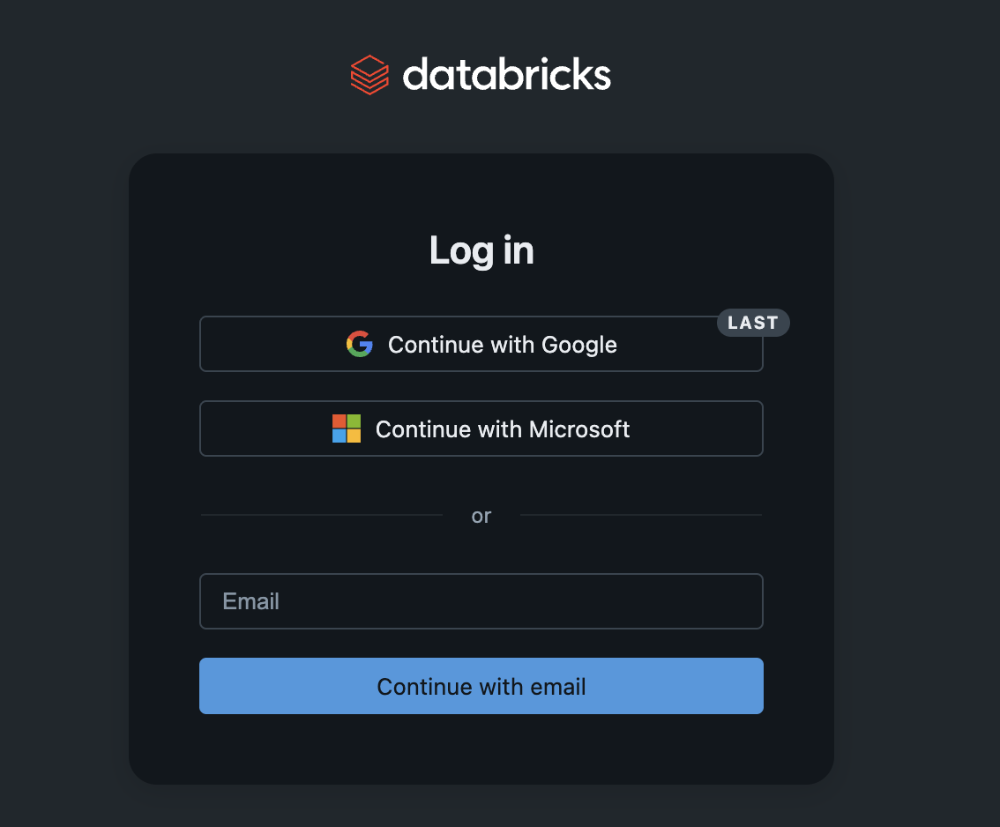
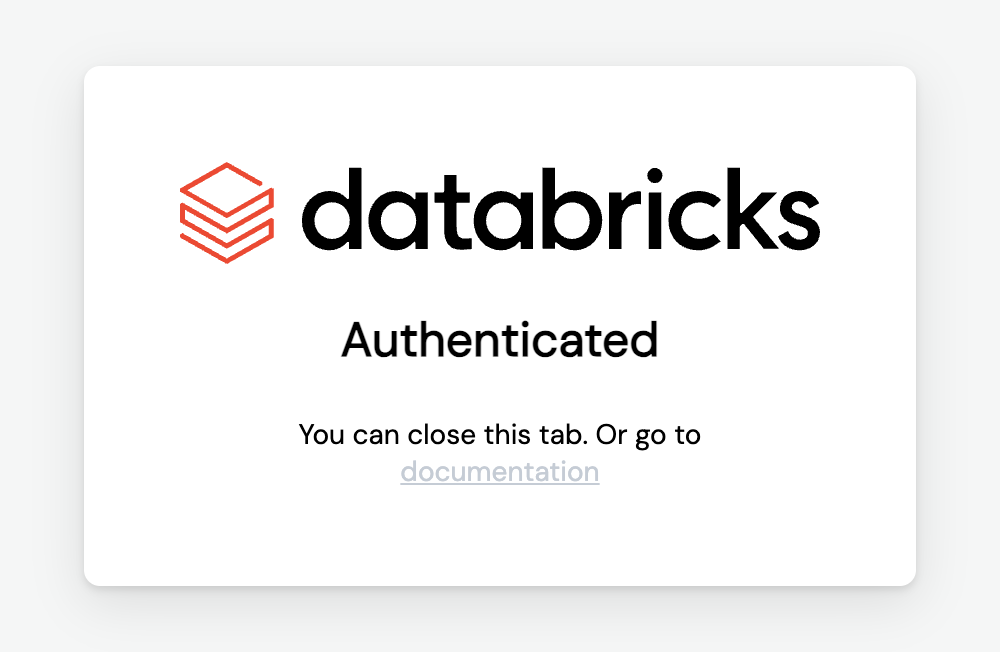

# Run a Text-to-SQL AI Agent on Databricks Free Edition: Step-by-Step Setup for Mac and Windows

*Last verified: November 2026. For the TorontoAI hands-on workshop. Maintained by [BeCloudReady](https://becloudready.com/).*

This guide takes you from nothing to a working **text-to-SQL AI agent** running as a **Databricks App** in your own free workspace. You ask a question in plain English, [db-agent](https://github.com/db-agent/db-agent) writes a read-only SQL query, runs it on a Databricks SQL warehouse, and shows you the SQL, the rows and an estimate of what the question cost.

You will:

1. Create a free Databricks account (Databricks Free Edition).
2. Install the Databricks CLI and log in.
3. Install `labagent`, a small command-line tool that deploys the app for you.
4. Launch db-agent with one command and ask it questions about the sample Bakehouse data.
5. Add an **ontology** (a short list of facts about your data) and watch wrong answers become right ones.
6. Remove everything with one command.

**Cost.** Databricks Free Edition is a no-cost version of Databricks. The one thing to watch is the daily compute quota, covered in [Free Edition limits](#free-edition-limits-to-know-about).

---

## What you need

| You need | Why | Mac | Windows |
|---|---|---|---|
| A Google, Microsoft or email account | To sign up for Databricks | any | any |
| Databricks CLI | Lets your terminal talk to your workspace | Homebrew | winget |
| Python 3.9 or newer | `labagent` is a Python tool | usually present | winget |
| Git | `labagent` fetches db-agent with it | usually present | winget |
| A terminal | Runs the commands | Terminal | PowerShell |

> **Tested on:** macOS. The Windows commands follow Databricks' official install guide and the labagent docs. labagent's own docs list Windows as untested, so if a Windows step fails, jump to [Troubleshooting](#troubleshooting) and tell your instructor.

---

## Step 1: Create a free Databricks account

1. Open the Databricks Free Edition signup page: <https://login.databricks.com/?dbx_source=docs&intent=CE_SIGN_UP>.
2. Choose **Continue with Google**, **Continue with Microsoft**, or enter an email address.
3. Databricks creates a workspace for you. Keep that browser tab open: you will need the workspace for the last steps.



Free Edition replaces the old Community Edition. It is serverless only, which suits this lab: there is no cluster to create.

---

## Step 2: Install the Databricks CLI

The Databricks CLI is what `labagent` uses to create your app, so install it first.

### Mac (Homebrew)

```bash
# Add the official Databricks tap
brew tap databricks/tap

# Trust the third-party tap (needed on current Homebrew)
brew trust databricks/tap

# Install the Databricks CLI
brew install databricks
```

### Windows (PowerShell)

```powershell
winget install Databricks.DatabricksCLI
```

Close PowerShell and open a new window afterwards so the new command is on your PATH. Databricks recommends running this as administrator.

### Linux or Windows with WSL

```bash
curl -fsSL https://raw.githubusercontent.com/databricks/setup-cli/main/install.sh | sh
```

### Check it worked

```bash
databricks -v
```

You should see a version number of 0.205.0 or higher.

---

## Step 3: Log in to your workspace

```bash
databricks auth login
```

On Windows PowerShell, run this first if the login fails to save your credentials:

```powershell
$env:DATABRICKS_AUTH_STORAGE="plaintext"
databricks auth login
```

Your browser opens. Sign in with the same method you used in Step 1. When the page says **Authenticated**, go back to the terminal.



Confirm the login:

```bash
databricks auth profiles
```

Your workspace should be listed with **Valid: YES**. The profile is called `DEFAULT` unless you named it something else.

---

## Step 4: Install labagent

[labagent](https://github.com/becloudready/labagent) builds a lab with one command and removes it with another. It has a ready-made `db-agent` pack.

### Mac

```bash
brew install pipx
pipx ensurepath
pipx install labagent
```

Open a new terminal, then check: `labagent packs`.

### Windows (PowerShell)

```powershell
# Python and Git, if you do not have them
winget install Python.Python.3.14
winget install Git.Git

# Open a NEW PowerShell window, then:
python -m pip install labagent
labagent packs
```

If `labagent` is "not recognized", the folder pip installed it into is not on your PATH. Run `python -m pip show -f labagent` to see where `labagent.exe` went, and add that folder to PATH, then open a new window.

---

## Step 5: Launch db-agent

Preview the steps first. Nothing is created:

```bash
labagent launch db-agent --name yourname --dry-run
```

Then run it for real. Pick a short name with letters and digits only. Your app will be called `db-agent-yourname`:

```bash
labagent launch db-agent --name yourname
```

If you have more than one Databricks profile, add `--param profile=DEFAULT` (use your profile name).

You will see the steps go by:

| Step | What happens |
|---|---|
| `preflight` | Checks your login, finds a SQL warehouse, finds the sample data and a model endpoint |
| `fetch` | Downloads db-agent at a fixed, reviewed version (a pinned commit) |
| `token` | Makes a 30-day access token and stores it only as an app secret |
| `app` | Deploys the Databricks App |
| `verify` | Asks a real question through the deployed app to prove everything works together |

If a step fails, fix the problem and run the same command again. `launch` resumes where it stopped.

**What it picks for you.** The data is `samples.bakehouse`, which exists in every workspace, so nothing is downloaded. The chat model is the first serving endpoint in your workspace whose name looks like a chat model, and the SQL warehouse is the first one found. To choose yourself, add `--param chat_endpoint=<name>`, `--param warehouse=<id or name>` or `--param dataset=<schema>`.

---

## Step 6: Open the app and ask questions

In your Databricks workspace, open **Compute**, then **Apps**, and click `db-agent-yourname`. (Names of menu items change between Databricks releases, so if you cannot find it, search the sidebar for "Apps".)

Try these, one at a time:

- `How many customers are there?`
- `How many franchises are in Japan?`
- `What is the revenue per product?`
- `Which product sold the most units?`

For each answer, read the three things db-agent shows:

1. **The SQL it wrote.** It only ever runs `SELECT`. Try asking it to delete something: it is refused before it reaches the database.
2. **The rows.** Check them against what you expect.
3. **The cost line.** One estimate for the language model (tokens) and one for the warehouse (compute). These are two separate bills, and most teams only look at one of them.

---

## Step 7: Add an ontology and see wrong answers turn right

Text-to-SQL goes wrong in a particular way: the SQL is valid, the query runs, and the answer is quietly wrong, because the model has to guess how your data is stored. In the Bakehouse data we tested, for example:

| Question | The model's natural guess | What the data holds |
|---|---|---|
| How many suppliers are approved? | `approved = 'Yes'` | `'Y'` |
| How many payments used visa? | `paymentMethod = 'Visa'` | `'visa'` (lowercase) |
| Revenue from female customers? | `gender = 'F'` | `'female'` |

An **ontology** (in db-agent, a *knowledge file*) is a short list of facts like these, in plain language, that is added to every prompt. Nothing about your tables changes.

1. Add `#ontology` to your app's address, or click **Ontology** in the app.
2. Click **Scan database**. It reads names, types and comments only (never your rows) and shows a readiness score and a to-do list.
3. Pick a table and add one line per column, such as: *"approved: 'Y' when the supplier is approved."*
4. Click **Save for the team**, then ask the same question again.

Why this matters: in our own test on the Bakehouse data, the same free 7B model scored 14 of 17 questions right without an ontology and 17 of 17 with one (17 questions, one run each, so treat it as one data point). Read the method and the limits in [the full write-up](https://becloudready.com/blog/ontology-text-to-sql-ai-database-agent-databricks).

---

## Clean up

```bash
labagent destroy db-agent --name yourname
```

This removes only what `launch` created and revokes the access token it made. Do this when you are finished. If your workspace blocks token creation, create a token yourself and set `LABAGENT_DATABRICKS_TOKEN`; labagent then uses it and never revokes it.

---

## Free Edition limits to know about

From Databricks' documentation:

- **One SQL warehouse**, size 2X-Small.
- **Up to 3 apps per account.** An app stops automatically **24 hours** after it was started, updated or redeployed. Restart it from the Apps page.
- **A daily compute quota.** If you go over, compute is shut down for the rest of the day (in extreme cases, the rest of the month). Your data is kept.
- **Serverless compute only**, and outbound internet access limited to trusted domains.

---

## Troubleshooting

| What you see | Fix |
|---|---|
| `labagent: command not found` or "not recognized" | The install folder is not on PATH. Mac: run `pipx ensurepath` and open a new terminal. Windows: see Step 4. |
| `databricks: command not found` | Open a new terminal after installing. On Windows, restart PowerShell. |
| `not authenticated: run databricks auth login and retry` | Run `databricks auth login` again, then `databricks auth profiles` and check **Valid: YES**. |
| Windows login does not stick | Set `$env:DATABRICKS_AUTH_STORAGE="plaintext"` in the same window, then log in again. |
| `preflight` fails on the sample data | It prints the schemas it did find. Pass `--param dataset=<one of them>`. |
| `preflight` cannot find a model or warehouse | Pass `--param chat_endpoint=<name>` or `--param warehouse=<name>`. |
| Questions suddenly all fail | The warehouse may have stopped, the app may have passed its 24 hours, or you hit the daily quota. Start the app again, wait, and retry. |
| Token creation is blocked | Create a token in Databricks yourself and set `LABAGENT_DATABRICKS_TOKEN`. |

---

## FAQ

**What is db-agent?**
An open-source text-to-SQL AI agent. It turns an English question into a safe, read-only SQL query, runs it, and shows the SQL, the rows and the cost. It runs on your laptop or as a Databricks App. [Source on GitHub](https://github.com/db-agent/db-agent).

**What is Databricks Free Edition?**
A no-cost, quota-limited version of Databricks for students, educators and hobbyists. It replaced Community Edition.

**What is labagent?**
A command-line tool that builds a hands-on lab in your own account with `launch` and removes it with `destroy`. Each lab is a re-runnable "pack". [Source on GitHub](https://github.com/becloudready/labagent).

**What is an ontology in text-to-SQL?**
A short, plain-language description of what your data means: which value means "approved", how revenue is calculated, what a column really holds. It gives the model facts that your schema does not contain, and it works with any model.

**Can I run it with a local model instead of paying for a hosted one?**
Yes. db-agent accepts any OpenAI-compatible endpoint, including Ollama on your own machine. See the [main README](../../../README.md) for the local setup.

**Is it safe to point at a real database?**
db-agent blocks every non-`SELECT` statement before it reaches the database. Use a read-only credential anyway, and try it on a throwaway workspace first.

---

## Next steps

- Read how an ontology moved a small free model from 14 to 17 correct answers: [the write-up](https://becloudready.com/blog/ontology-text-to-sql-ai-database-agent-databricks), and the [ontology guide](../ontology.md).
- Connect Claude Desktop, VS Code or Claude Code to the same database through the [MCP gateway](../mcp-gateway.md).
- Run db-agent on your laptop with a local model: [README](../../../README.md).
- Want this taught to your team? [Book a call with BeCloudReady](https://calendly.com/kchandank/30-mins-meeting).

*Built by [BeCloudReady](https://becloudready.com/), organizers of [TorontoAI](https://toronto-ai.org/).*
